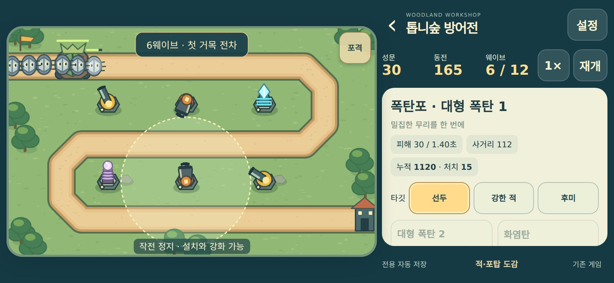
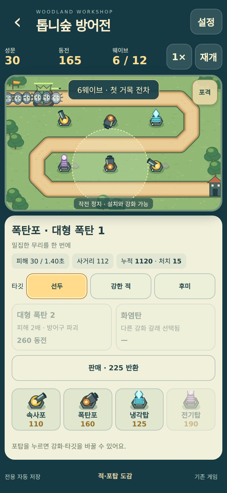
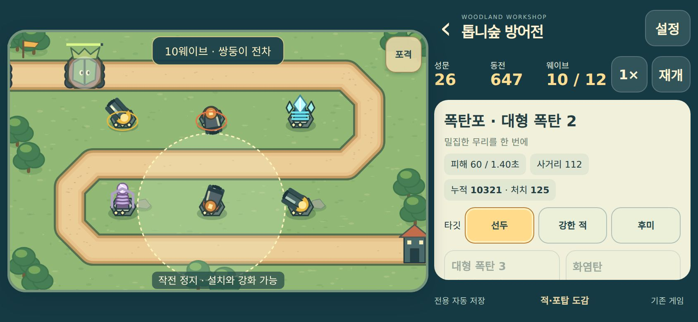

# 톱니숲 방어전 — MOONWARD 전면 재제작

이 버전은 PR #222의 5웨이브 전술전도 재미가 부족하다는 피드백을 반영한 별도 재제작이다. #222 위에 추가한 것이 아니라 최신 main에서 새로 만들었다. 두 PR을 함께 병합하지 않는다.

## 무엇을 바꿨나

- 고정 제단과 소환·합성을 없애고 길 옆 자유 배치로 바꿨다. 빈 땅을 눌러 사거리와 설치 가능 여부를 보고, 설치 버튼으로 확정한다.
- 속사포·폭탄포·냉각탑·전기탑을 직접 구매한다. 총열·박격포·얼음 수정·코일 실루엣, 탄환·폭발·감속 파동·연쇄 번개가 실제 공격 역할과 연결된다.
- 각 포탑은 두 갈래 중 하나를 선택해3단계까지 성장한다. 단순 공격력만이 아니라 쌍열 기관포, 갑옷 관통 저격, 넓은 폭발, 지속 화염, 광역 감속, 연쇄/집중 번개로 달라진다.
- 선두·강한 적·후미 타깃을 고를 수 있다. 폭탄의 선두 기본값은 사거리 안 밀집군을 노려 광역 낭비를 줄인다.
- 12웨이브에 질주·철갑·분열 수송체·거목 전차를 순서대로 도입한다. 단단한 외피를 깨면 빠른 작은 적이 실제로 분열한다. 전차도 처치 후 잔여 적을 처리해야 웨이브가 끝난다.
- 긴급 포격을 직접 조준할 수 있다. 갑옷을 무시하는 피해260, 반경75, 재사용32초. 전투 시간 기준이라 정지 중에는 재사용 시간이 줄지 않는다.
- 가로/세로, 전투 중 작전 정지·구매·강화·판매, 배속, 음소거, 효과 줄이기, 중간 저장, 재시작·나가기를 제공한다. 판매는 투자금75%를 돌려준다.

참고한 것은 Bloons TD 6의 **직접 배치·현금 강화·판매·웨이브 방어**라는 플레이 구조다. [공식 배급사 플레이 안내](https://help.netflix.com/en/node/718990757024356)를 확인했다. 해당 게임의 코드·캐릭터·맵·UI·수치·이미지·음원을 가져오지 않았다. 원본 게임을 직접 플레이했다는 주장은 하지 않는다.

## 가로모드 버튼

상단 **가로모드**를 누르면 문서 전체화면을 요청한 뒤 `screen.orientation.lock("landscape")`를 호출한다. 다시 누르거나 전체화면에서 나가면 잠금을 해제하며, 페이지를 나갈 때도 정리한다. API 미지원·거절 시 수동 회전 안내를 제공한다. CSS로 화면을 억지로 돌리지 않아 터치 좌표는 그대로 유지한다. [Screen Orientation API 참고](https://developer.mozilla.org/en-US/docs/Web/API/ScreenOrientation/lock).

성공·미지원·거절·중복 탭·전체화면 종료·요청 중 이탈은 모의 API 테스트, 실제 버튼·전체화면 복귀·화면 크기·게임 상태 보존은 헤드리스 Chromium에서 확인한다. 실제 Android/iPhone 회전은 실기기 미확인이다.

## 실행

저장소 루트에서:

```sh
python3 -m http.server 8000
```

`http://localhost:8000/arcade/moonward/frontier/` 접속. 기존 아케이드 링크 `arcade/moonward/`도 새 전장으로 이동한다. 기존 랜덤 게임은 `arcade/moonward/?classic`에서 그대로 실행한다. 런타임 외부 의존성·폰트·이미지 요청이 없다.

포탑 카드 → 길 옆 위치 → 설치 → 웨이브 시작. 굽이 안쪽은 두 길을 함께 공격할 수 있다. 포탑을 누르면 사거리·누적 피해·처치·강화·타깃을 확인한다. 포격은 전장 오른쪽 위 버튼을 누른 뒤 적이 있는 길을 누른다.

## 아트 방향과 출처

밝은 세이지색 숲, 모래색 길, 짙은 청록 외곽선, 황동 기계와 파스텔 원소의 오리지널 벡터 아트다. `render.mjs`에서 직접 그린 나무·지형·공방·포탑·벌레·수송체·전차와 효과를 사용한다. 외부 리소스나 기존 MOONWARD 일러스트를 쓰지 않는다. 정식 상용 게임의 아트 품질과 동등하다는 보장은 하지 않는다. 폰트는 기기 시스템 폰트이며, 테스트 캡처 환경에만 Noto Sans CJK KR를 설치했다.

실제 캔버스 캡처:





## 수치와 조정 근거

`data.mjs`에 비용·공격·사거리·강화·적·웨이브를 분리했다. 전투 엔진은30Hz 고정 간격으로 실행되고 화면 배속은 동일 step을 더 호출한다. 진행 중 발사체와 지속 화염까지 저장한다.

| 포탑 | 기본 비용 | 피해 / 간격 | 사거리 | 역할 |
|---|---:|---|---:|---|
| 속사포 | 110 | 12 / 0.34초 | 125 | 빠른 단일 공격 |
| 폭탄포 | 160 | 30 / 1.4초 | 112 | 반경38 광역 |
| 냉각탑 | 125 | 3 / 1.1초 | 100 | 최대5명, 35% 감속 |
| 전기탑 | 190 | 22 / 0.85초 | 118 | 갑옷 무시, 3명 연쇄 |

초기 자금340으로 속사포+폭탄포 또는 속사포+전기탑을 바로 설치할 수 있다. 초안의 자동 혼합 전략은 종료 시 평균4300여 동전이 남아 최종 강화 선택이 너무 일찍 끝났다. 3단계 비용을430~500에서650~900으로 올린 뒤 같은 비교를 다시 수행했다. 자동 혼합 전략의 잔여 자금은 약2200~2300으로 감소했다. 일부는 마지막 웨이브 처치 수입이므로 전투 중 투자 전략과는 다르다.

여섯 단순 전략, 시드1~20의120판 비교(`tests/simulate.mjs`, 원자료 `tests/evidence/balance.json`):

| 자동 전략 | 승리 /20 | 평균 성문 | 평균 도달 웨이브 | 평균 전투 시간 |
|---|---:|---:|---:|---:|
| 혼합: 기관포·대폭발·빙하·집중전류 |20|26.55|12|530.2초|
| 혼합: 저격·화염·서리탄·연쇄 |20|29.75|12|473.2초|
| 12기 넓게 분산 투자 |20|19.9|12|538.7초|
| 속사포만 |0|0|7|310.1초|
| 폭탄포만 |20|9.95|12|488.3초|
| 집중 전기탑만 |0|0|10.2|432.0초|

자동 전략은 웨이브 사이에 정해진 순서로 구매·강화하며 포격을 사용하지 않는다. 표는 인간 승률도, 재미 검증도 아니다. 폭탄 위주의 다른 조합도 통과하지만 성문 손실이 크고, 두 혼합 경로는 모두 완주한다. 1× 전투 시간은 약8~9분에 준비 시간이 추가되며 2×는 더 짧다. 실제 사람 평균 플레이 시간은 미측정이다.

## 검사와 한계

```sh
node --test arcade/moonward/frontier/tests/engine.test.mjs arcade/moonward/tests/*.test.mjs
node arcade/moonward/frontier/tests/simulate.mjs
NODE_PATH=/path/to/node_modules MOONWARD_CHROMIUM=/path/to/chromium node arcade/moonward/frontier/tests/browser.cjs
# 실제 시간 전체 전투: 2배속 약4~5분 + UI 조작 시간
NODE_PATH=/path/to/node_modules MOONWARD_CHROMIUM=/path/to/chromium FRONTIER_REALTIME=1 node arcade/moonward/frontier/tests/browser.cjs
```

- 새 엔진9개+기존35개 테스트: 설치 원자성, 강화 갈래 잠금, 판매, 갑옷/관통, 실제 분열과 중복 보상, 감속/포격, 발사체·화염 저장 후 동일 진행, 손상 저장, 패배·초기화, 서로 다른 조합의 결과를 검사한다.
- 새 브라우저 검사는 실제 버튼으로 자유 배치·금지 위치·강화·타깃·포격·저장·승패·재도전을 조작한다. 전체12웨이브는 엔진 가속 실행으로도 재현한다. 별도로 실제 RAF 2× 전투로12웨이브 승리·재도전까지12개 검사를 통과했다(`tests/evidence/realtime-report.json`). 이후 패널 가독성과 손상 저장 검증을 보완하고 최신 화면에서 전체 엔진 가속/UI/오프라인 검사를 재실행했다. 브라우저 보고서의 `realtime` 값으로 실제 RAF 진행 여부를 구분한다.
- 320×568,390×844,430×932,568×320,667×375,844×390,1024×768: 가로 넘침·전장 비율·회전 상태 유지·구매/HUD44px 터치 영역 검사. 첫 캡처에서 헤더 최소 너비 때문에 가로 넘침을 발견해 수정했다. 강화가 구매 카드 아래로 밀리는 문제를 포탑 선택 시 강화 우선 패널로 수정했다.
- 실제 공용 서비스워커로 아케이드 진입·첫 방문 캐시·오프라인 이어하기/나가기·금융 저장 키 보존을 확인한다. 기존 게임24개 브라우저 검사와 기존 게임의 오프라인 통합도 별도로 실행한다.
- 금융·공용 PWA·저장 롤백·계산 회귀를 실행한다. 검사 외 공용 파일은 수정하지 않는다.
- 적50/100/200개 캔버스 렌더 제출 시간을 기록한다. 이것은 헤드리스 데스크톱 측정이며 휴대전화 FPS가 아니다.
- **미검증:** 실제 Android/iPhone, Safari, 설치형 PWA의 기기별 회전/백그라운드, 장시간 배터리·메모리, 사람이 처음 봤을 때의 이해도와 반복 재미. 모바일 실기기 검증 완료라고 보고하지 않는다.

## Claude 인계

수정은 `arcade/moonward/` 내부로 제한했다. 루트 index.html/app.css/sw.js/js/scripts/공용 설정·의존성·워크플로·금융·다른 게임은 변경하지 않는다.

- 기존 메뉴 href `arcade/moonward/` 유지 가능. 게임 내부 `frontier-entry.mjs`가 `frontier/`로 연결한다. 메뉴 이름을 바꾼다면 **톱니숲 방어전 / 자유 배치·강화 디펜스**를 사용한다.
- 저장 키 `firemate_frontier_v1`만 사용한다. `firemate_moonward_v1`과 PR #222의 `firemate_moonward_tactics_v1`, 금융 키를 읽거나 덮어쓰지 않는다. 기존 모드는 `?classic`, 기존 테스트는 `?test`로 원래 앱을 로드한다.
- 현재 공용 SW의 `/arcade/` 런타임 캐시로 첫 온라인 방문 이후 오프라인 실행된다. 첫 방문 이전에도 오프라인 실행이 필요하면 Claude가 공용 사전 캐시에 `frontier-entry.mjs`, `frontier/index.html`, `frontier/style.css`, `frontier/app.mjs`, `frontier/data.mjs`, `frontier/engine.mjs`, `frontier/render.mjs`, `frontier/landscape.mjs`를 함께 넣는다. 별도 이미지 파일은 없다.
- 다른 게임이 main에 추가되어 기존 통합 테스트의 고정 메뉴 목록이 낡아 있었으므로 새 게임 링크 두 개를 기대 목록에 반영했다. 해당 게임의 코드는 변경하지 않았다.
- PR #222는 이 재제작으로 대체한다. main 병합과 배포는 이번 작업 범위에 포함하지 않는다.
