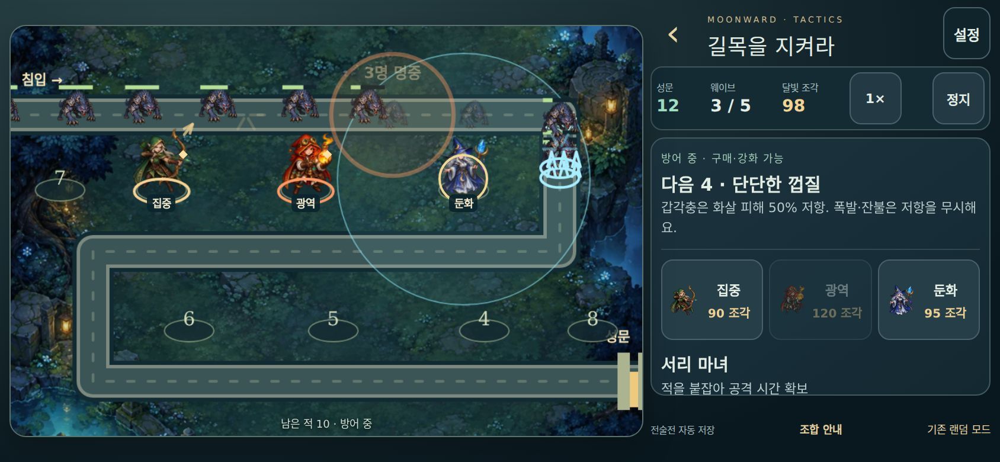
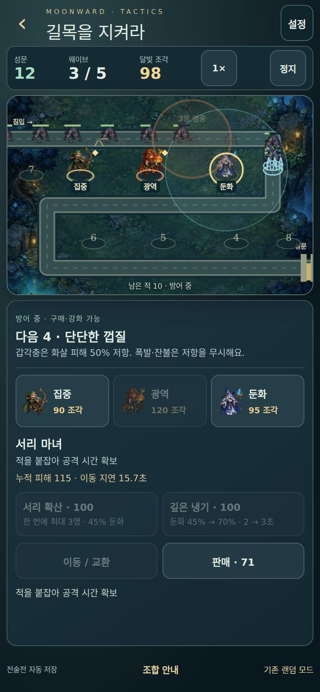

# MOONWARD — 길목을 지켜라

2026-10-31 전투 개편. 무작위 소환·합성 반복을 직접 구매 → 배치 → 갈림길 강화 → 웨이브 대응으로 바꾼 독립 전술전이다. 기존 랜덤 모드와 저장은 보존한다.

## 실행

저장소 루트에서 `python3 -m http.server 8000` 실행 후 `http://localhost:8000/arcade/moonward/tactical/`에 접속한다. 기존 아케이드의 `/arcade/moonward/` 링크도 이 모드로 이동한다. 기존 모드는 `/arcade/moonward/?classic`이다. 런타임 외부 의존성은 없다.

역할 카드를 누르고 빈 제단을 눌러 구매한다. 첫 230조각으로 궁수+광역을 바로 배치할 수 있다. 유닛 선택 시 사거리와 실제 기여도, 두 강화 선택지가 표시된다. 강화는 미리보기와 확인을 거치고 한 갈래만 고를 수 있다. 준비 시간에는 무료 이동·교환, 전투 중에는 정지·구매·강화·판매가 가능하다. 다음 웨이브의 적과 대응 설명을 보고 출발한다. 마지막 보스가 성문에 도달하면 패배한다.

## 설계와 수치

한 맵, 세 역할, 다섯 웨이브로 축소했다. 원래 10~15분 목표를 늘리는 대신 먼저 짧은 전투의 선택과 가독성을 확인하기 위한 범위다. 자동 전략의 전투 시간은 약 2.6~3.3분이며, 준비·조작 시간은 제외했다. 실제 사람의 플레이 시간은 미측정이다.

| 역할 | 비용 | 기본 공격 | 강화 선택 |
|---|---:|---|---|
| 궁수·집중 | 90 | 22 / 0.65초, 사거리98 | 속사 0.32초 / 3명 관통 |
| 연금술사·광역 | 120 | 28 / 1.6초, 반경37 | 폭발 반경62 / 바닥 잔불 |
| 마녀·둔화 | 95 | 5 / 0.9초, 45% 둔화 | 3명 확산 / 70% 깊은 냉기 |

느려진 적에게 폭발이 겹치면 실제 명중 수와 연계를 표시한다. 별도 숨은 연계 피해 배율은 없다. 광역은 밀집한 무리를, 둔화는 아직 느려지지 않은 적을 우선한다. 갑각충은 화살 피해를 50% 줄여 광역·잔불의 역할을 만든다. 보스는 둔화 효과를 절반으로 받는다. 모든 수치는 `data.mjs`, 전투 규칙은 `engine.mjs`에 분리했다.

## 밸런스 검증과 수정

동일 엔진, 시드1~30, 여섯 단순 자동 전략(180판)의 결과다. 사람의 승률이나 재미 평가가 아니다. 전략별 구매·강화 순서는 `tests/simulate.mjs`, 원자료는 `tests/evidence/balance.json`에 있다.

| 전략 | 승리 / 30 | 평균 남은 성문 | 평균 전투 초 |
|---|---:|---:|---:|
| 혼합: 속사·대폭발·확산 | 30 | 11.9 | 157.7 |
| 혼합: 속사·잔불·깊은 냉기 | 30 | 11.9 | 154.6 |
| 같은 역할, 분산 배치 | 15 | 3.8 | 197.8 |
| 궁수만 | 14 | 4.0 | 166.4 |
| 둔화만 | 0 | 0 | 45.8 |
| 광역만 | 0 | 0 | 88.2 |

초안에서는 보스를 놓쳐도 성문이 남아 승리할 수 있었다. 보스 통과 피해를12로 바꾸고, 적절한 혼합 조합도 보스 체력이145 남아 놓치던 결과를 바탕으로 보스 체력을2200에서1900으로 낮췄다. 두 혼합 강화 경로가 모두 성립하고 배치 차이가 결과에 반영되는 것을 확인했다. 단순 전략에 맞춰진 결과이므로 최적 전략의 다양성·장기 반복 재미가 입증된 것은 아니다.

## 화면과 검증

기존 독창적 숲·캐릭터 WebP를 재사용한다. 출처·제작 기록은 [기존 ART.md](../ART.md)를 따른다. 새 외부 리소스는 추가하지 않았다. 투사체, 폭발 범위, 얼음, 잔불, 피격·사망·강화 효과를 실제 공격과 연결했다. 모션 줄이기·음소거를 제공한다.




재현 명령(브라우저 테스트는 외부에 설치한 Playwright와 Chromium 필요):

```sh
node --test arcade/moonward/tactical/tests/engine.test.mjs arcade/moonward/tests/*.test.mjs
node arcade/moonward/tactical/tests/simulate.mjs
NODE_PATH=/path/to/node_modules MOONWARD_CHROMIUM=/path/to/chromium node arcade/moonward/tactical/tests/browser.cjs
NODE_PATH=/path/to/node_modules MOONWARD_CHROMIUM=/path/to/chromium MOONWARD_REALTIME=1 node arcade/moonward/tactical/tests/browser.cjs
NODE_PATH=/path/to/node_modules MOONWARD_CHROMIUM=/path/to/chromium node arcade/moonward/tests/browser.cjs
NODE_PATH=/path/to/node_modules MOONWARD_CHROMIUM=/path/to/chromium node arcade/moonward/tests/integration.cjs
```

새 엔진9개+기존35개 테스트 통과. 구매·강화·판매 원자성, 둔화·광역·6강화의 실제 효과, 보스 통과 패배, 저장 후 동일 진행, 중복 보상 방지, 손상 저장, 프레임 분할 동등성을 확인한다. 브라우저에서는 실제 버튼으로 구매·강화·회전·재개·보스·승패·재시작을 조작했다. 가속 엔진 실행과 별도로 실제 RAF 전투를 2× 속도로 5웨이브 끝까지 진행해 승리·재도전까지14개 검사를 통과했다. 기존 랜덤 모드 브라우저24개 검사도 통과했다. 캡처는 한글 글꼴을 설치한 테스트 환경에서 가속 실행한 전투 장면이다. 320×568부터1024×768까지7개 크기에서 44px 배치 터치 영역, 겹침·넘침·전장 비율을 검사한다. 자동 테스트용 엔진 접근은 `?test`에서만 노출된다.

로컬 공용 서비스워커 통합에서는 첫 온라인 진입 후 오프라인 재접속·이어하기·나가기와 금융 저장 키 보존을 확인했다. 공용 PWA·저장 롤백·금융 계산 회귀도 실행했다. 증거는 `tests/evidence/`에 보관한다.

**한계:** 실제 휴대전화, iOS Safari, 사람의 첫 플레이 이해도·재미·장시간 반복·배터리 사용량은 미검증이다. 헤드리스 데스크톱의 30/60/100적 렌더 제출 시간은 휴대전화 FPS가 아니다. 현재 작업은 PR 검토용이며 main 병합·배포는 포함하지 않는다.

## Claude 연결 안내

- 수정 범위는 `arcade/moonward/`뿐이다. 금융 파일, 다른 게임, 루트 index.html/app.css/sw.js/js/scripts/설정/워크플로/공용 의존성은 수정하지 않았다.
- 기존 아케이드 링크 `arcade/moonward/`는 `entry.mjs`를 통해 `tactical/`로 이동하므로 메뉴 경로 변경은 필수가 아니다. 메뉴 설명을 바꾼다면 “길목을 지켜라 · 집중/광역/둔화 배치 전술전”을 권장한다.
- 기존 모드를 직접 연결하려면 `arcade/moonward/?classic`을 사용한다. 기존 저장을 새 형식으로 덮어쓰거나 이관하지 않는다.
- 전용 키는 `firemate_moonward_tactics_v1`; 기존 키 `firemate_moonward_v1`과 금융 키는 그대로 둔다. 재시작/손상 복구는 새 키만 처리한다.
- 현재 서비스워커의 `/arcade/` 런타임 캐시로 최초 온라인 방문 이후 오프라인 실행을 검증했다. 처음부터 오프라인에서 실행해야 한다면 Claude가 공용 캐시 정책에 `entry.mjs`, `tactical/index.html`, `style.css`, `app.mjs`, `data.mjs`, `engine.mjs`, `render.mjs`와 `render.mjs`에서 읽는 `../art/*.webp`를 함께 사전 캐시해야 한다. 이번 PR에서 sw.js는 변경하지 않는다.
- `entry.mjs`를 포함한 새 진입점이 캐시 갱신되었는지 배포 후 확인한다. 서브 경로 설치에서 상대 URL을 유지한다.
- 페이지 이탈 시 RAF/오디오를 종료하고, 숨김·bfcache 복귀에는 정지 상태로 전환한다. 무거운 이미지와 오디오는 게임 진입 후에만 사용한다.
